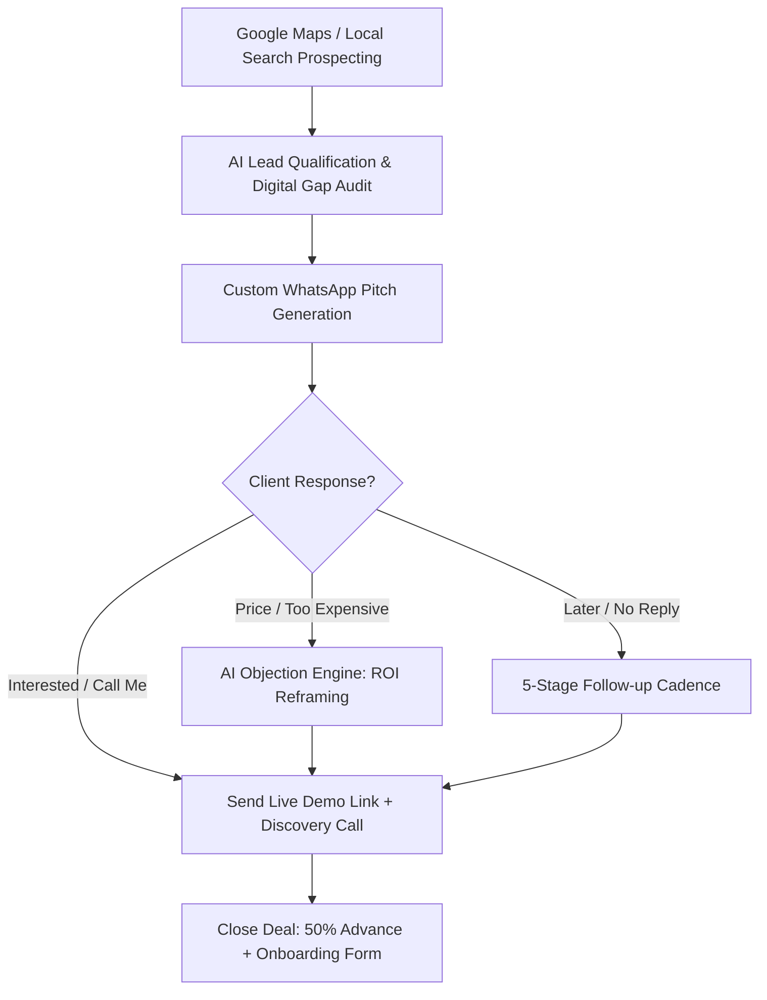

# 🤖 SHAKTIX Autonomous AI Sales Agent Blueprint

*Version 2.0 | Chief Sales Officer (CSO) Architecture*

---

## 🎯 Executive Summary
The **SHAKTIX AI Sales Agent** is engineered to automate the entire top-of-funnel and mid-funnel client acquisition pipeline for SHAKTIX Web Studio. It operates as an always-on sales assistant capable of:
1. **Auditing Local Businesses** (Finding pain points on Google Maps, JustDial, Instagram).
2. **Generating Hyper-Personalized WhatsApp & Email Pitches** within seconds.
3. **Overcoming Objections** dynamically with psychologically grounded rebuttals.
4. **Triggering 5-Stage Follow-Up Sequences** so no interested lead goes cold.
5. **Auto-Formatting Custom Proposals & Invoices** with 1 click.

---

## 🏗️ System Architecture

---

## 📊 Lead Scoring Matrix (Qualifying High-Ticket Clients)

| Metric | Score (+ / -) | Qualifying Action |
| :--- | :--- | :--- |
| Google Rating > 4.2 with 50+ reviews | **+30 pts** | High existing customer trust; can easily afford ₹10k-₹20k. |
| Has NO website link on Google Profile | **+40 pts** | Prime target for Starter/Growth Package. |
| Existing website is NOT mobile-friendly | **+35 pts** | Prime target for complete redesign. |
| Running paid Google/Meta ads without landing page | **+50 pts** | Urgent need; they are bleeding ad money every day. |
| Negative Google rating (< 3.0) | **-30 pts** | Low reputation; difficult client, skip. |

---

## ⏱️ Daily 30-Minute CEO Routine (With AI Agent)
1. **10 Mins**: Find 10 local businesses on Google Maps (Doctors, Gyms, Cafes, Salons).
2. **10 Mins**: Paste names & details into the **SHAKTIX AI Sales Desk** (`/ai-agent/index.html`).
3. **5 Mins**: Review generated customized pitches and click **Send via WhatsApp Web**.
4. **5 Mins**: Run Follow-up Cadence for prospects from Day 2 & Day 4.

**Expected Conversion**: Out of 10 daily outreaches (300/month), expect 15-20 interested calls, closing **4 to 8 website projects per month** (Revenue: ₹40,000 to ₹1,00,000+).
